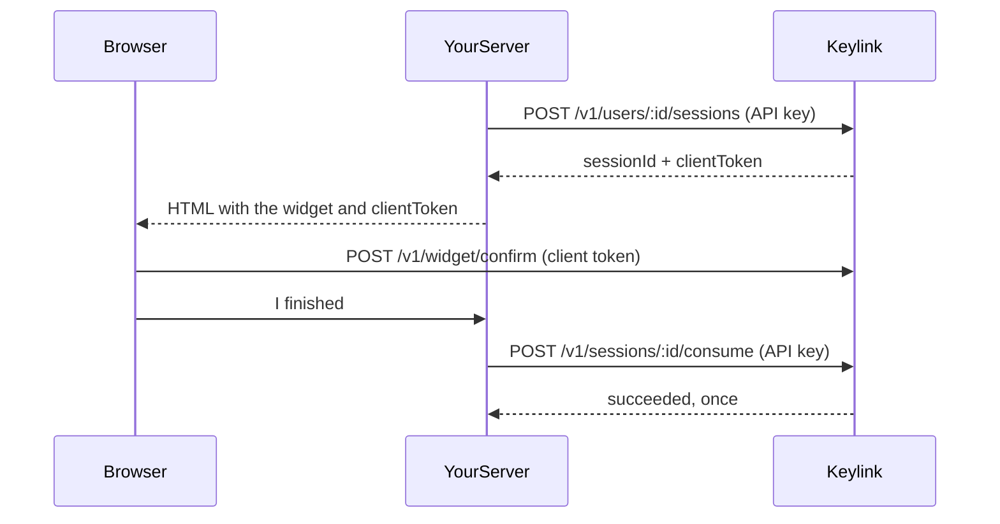

# Keylink

Keylink is a self-hosted second factor. Your application keeps the password. Keylink keeps authenticator secrets, checks the codes, and stops guessing.

It speaks [RFC 6238](https://www.rfc-editor.org/rfc/rfc6238) TOTP, so Google Authenticator, Authy, 1Password, and any other standard app can enroll. It also issues single-use backup codes, locks a user out after repeated failures, and gives you a small widget plus server SDKs so the integration stays short.

Passkeys (WebAuthn) and email codes have a place in the data model and the API, and currently return `501`. They are not pretend implementations.

## What you run

| Piece | What it is |
| --- | --- |
| Server | API, admin console, secret storage. Default port `4780`. |
| Widget | Browser UI for enroll and verify. Loaded from the server or from npm. |
| `@keylink/sdk` | Node.js client for your backend. |
| `keylink-sdk` | Python client for your backend. |
| Fieldnote | A demo notebook that uses all of the above. Port `4781`. |

Secrets are encrypted with AES-256-GCM under a master key you provide. API keys and backup codes are stored as hashes. Used TOTP time steps are remembered so a code cannot be replayed inside its window.

## Quick start with Docker

```bash
docker compose up --build
```

- Console: http://localhost:4780/admin — password `change-me` until you set `KEYLINK_ADMIN_PASSWORD`
- Demo: http://localhost:4781 — `ada@fieldnote.test` / `notebook`

Compose writes an API key for the demo to the Keylink data volume. Change `KEYLINK_MASTER_KEY` and `KEYLINK_ADMIN_PASSWORD` before anyone else can reach the console. A 32-byte key is 64 hex characters:

```bash
node -e "console.log(require('crypto').randomBytes(32).toString('hex'))"
```

Any other string is stretched with scrypt. Losing the master key means existing authenticator secrets cannot be decrypted. Rotation is a new enrollment.

## Quick start without Docker

Node.js 22 or newer and pnpm 10.

```bash
pnpm install
pnpm build
export KEYLINK_MASTER_KEY="$(node -e "console.log(require('crypto').randomBytes(32).toString('hex'))")"
export KEYLINK_ADMIN_PASSWORD="a-local-password"
export KEYLINK_BOOTSTRAP_APP="Fieldnote"
export KEYLINK_BOOTSTRAP_ORIGINS="http://localhost:4781,http://127.0.0.1:4781"
export KEYLINK_API_KEY_FILE="./data/bootstrap-api-key"
pnpm dev
```

The first boot creates the Fieldnote application and writes `./data/bootstrap-api-key`. The demo reads that file.

## Integrate a site

The browser never sees your API key. Your server creates a short-lived session, the widget uses that session token, and your server then **consumes** the session before trusting the result. A successful widget callback is not proof on its own.



### Node.js

```bash
pnpm add @keylink/sdk
```

From this repository, depend on the workspace package or on `packages/sdk` after `pnpm --filter @keylink/sdk build`.

```ts
import { Keylink } from "@keylink/sdk";

const keylink = new Keylink({
  baseUrl: "http://localhost:4780",
  apiKey: process.env.KEYLINK_API_KEY!,
});

await keylink.upsertUser("user_123", { displayName: "Ada Lovelace" });

const enroll = await keylink.createSession("user_123", { purpose: "enroll" });
// enroll.clientToken goes to the widget. enroll.totp.qrSvg if you render the QR yourself.

const verified = await keylink.verifyCode("user_123", "123456");
// or, after the widget: await keylink.consumeSession(enroll.sessionId)

const status = await keylink.getUser("user_123");
```

`verifyCode` is the direct path when your own form collects the digits. `createSession` plus the widget is the drop-in path. `consumeSession` succeeds only once, and only after the widget (or a direct confirm) has accepted a code.

### Python

```bash
pip install -e packages/sdk-python
```

```python
from keylink import Keylink

keylink = Keylink("http://localhost:4780", api_key="kl_live_...")
keylink.upsert_user("user_123", display_name="Ada Lovelace")
session = keylink.create_session("user_123", purpose="enroll")
status = keylink.get_user("user_123")
keylink.verify_code("user_123", "123456")
keylink.consume_session(session["sessionId"])
```

### Widget

The server hosts a browser bundle at `/widget.js`.

```html
<script src="http://localhost:4780/widget.js" defer></script>
<div id="twofa"></div>
<script>
  document.addEventListener("DOMContentLoaded", function () {
    Keylink.mount("#twofa", {
      baseUrl: "http://localhost:4780",
      sessionToken: CLIENT_TOKEN_FROM_YOUR_SERVER,
      onSuccess: function () {
        document.getElementById("done").submit();
      }
    });
  });
</script>
<form id="done" method="post" action="/2fa/complete" hidden></form>
```

Your `/2fa/complete` handler calls `consumeSession` (or `consume_session`). Check that `purpose` is the one you started.

Declarative mount, no extra script:

```html
<div data-keylink data-base-url="http://localhost:4780" data-session-token="kls_..."></div>
```

Or a custom element: `<keylink-widget base-url="..." session-token="..."></keylink-widget>`. It fires `keylink-success` and `keylink-error`.

npm: import `{ mount }` from `@keylink/widget` after building `packages/widget`.

The widget sends `Authorization: Bearer` and `credentials: "omit"`. It does not use cookies, so a third-party page cannot ride a Keylink session. The server only answers browser calls whose `Origin` is on that application's allow list. Add the origin in the console (scheme, host, and port; no path).

### Theming the widget

Variables inherit into the widget. Set them on the host page:

```css
:root {
  --keylink-bg: #faf7f0;
  --keylink-fg: #1d2430;
  --keylink-muted: #5c6573;
  --keylink-border: #1f4d45;
  --keylink-line: #d8d1c2;
  --keylink-accent: #1f4d45;
  --keylink-accent-fg: #f4fbf8;
  --keylink-danger: #8e1b3a;
  --keylink-font: "Public Sans", sans-serif;
  --keylink-mono: "IBM Plex Mono", ui-monospace, monospace;
  --keylink-radius: 0px;
}
```

Fieldnote in `packages/demo` is a working example, including a dark theme. The QR code stays dark-on-white so cameras can read it.

### Where a host site should enforce the check

1. Check the password in your application.
2. `getUser`. If `enrolled` is false, send the user to an enroll screen (`purpose: "enroll"`).
3. If `enrolled` is true, create a `verify` session and show the widget. Do not issue your own session cookie yet.
4. On the completion request, `consumeSession`. Continue only when `status` is `succeeded` and `purpose` is `verify`.

Backup codes are returned once, from the enroll confirmation, and the widget shows them before it calls `onSuccess`. Regenerating (`regenerateBackupCodes` / `regenerate_backup_codes`) invalidates the previous set. `disableTotp` removes the authenticator and the codes.

## API

All `/v1` routes except the widget use `Authorization: Bearer kl_live_...`.

| Method | Path | Purpose |
| --- | --- | --- |
| `PUT` | `/v1/users/:externalId` | Create or update a user. |
| `GET` | `/v1/users/:externalId` | Enrollment and lock status. |
| `POST` | `/v1/users/:externalId/sessions` | `{ "purpose": "enroll" \| "verify" }`. Returns `clientToken`. |
| `GET` | `/v1/sessions/:sessionId` | Status, without the client token. |
| `POST` | `/v1/sessions/:sessionId/consume` | Accept a succeeded session exactly once. |
| `POST` | `/v1/users/:externalId/verify` | `{ "code": "123456" }` or a backup code. |
| `POST` | `/v1/users/:externalId/backup-codes` | Replace backup codes. The plaintext is returned once. |
| `DELETE` | `/v1/users/:externalId/totp` | Remove the authenticator and backup codes. |
| `GET` | `/v1/factors` | Which factors this server implements. |
| `GET` | `/v1/widget/session` | Widget session token, not the API key. |
| `POST` | `/v1/widget/confirm` | `{ "code" }`. |
| `POST` | `/v1/users/:id/webauthn/register` | `501` until passkeys are implemented. |
| `POST` | `/v1/users/:id/email/challenge` | `501` until email codes are implemented. |

Errors look like `{ "error": { "code": "invalid_code", "message": "..." } }`. Lockout is HTTP 423. A wrong code is 401 and includes `remainingAttempts` until the lock.

External ids are 1–128 characters: letters, digits, and `. _ : @ + -`.

## Console

`/admin` is for operators. Create an application, set the browser origins, issue an API key (shown once), see users, and clear a lockout. The console cookie is `HttpOnly` and `SameSite=Lax`, and state-changing forms send a CSRF token.

## Security model

- **Master key.** `KEYLINK_MASTER_KEY` as 64 hex characters, or a passphrase stretched with scrypt. TOTP secrets are AES-256-GCM with the user id as additional data, so a ciphertext cannot be moved to another user.
- **API keys.** `kl_live_` plus 32 random bytes. Only a SHA-256 hash is stored. The console shows the key once.
- **Session tokens.** `kls_` tokens for the widget are hashed at rest, expire (10 minutes by default), and are bound to one user and one purpose.
- **Comparison.** Code and token comparisons use `crypto.timingSafeEqual`.
- **Replay.** An accepted TOTP step is stored. A later presentation of that step, or an earlier one, is rejected even when the digits match. The default window is ±1 step (30 seconds).
- **Backup codes.** Eight codes, HMAC-SHA256 under the master key, single use. Every stored hash is compared.
- **Lockout.** Five failures by default, then 15 minutes. `KEYLINK_MAX_FAILURES` and `KEYLINK_LOCKOUT_MS` change it. There is also a per-IP attempt limit.
- **Browser calls.** Widget routes require the `Origin` to match the application's allow list. No cookies are used on those routes.
- **Production.** `NODE_ENV=production` refuses to start without `KEYLINK_MASTER_KEY` and `KEYLINK_ADMIN_PASSWORD`.

The admin password is checked with scrypt. Audit events record actions, not codes or secrets.

## Configuration

| Variable | Default | Meaning |
| --- | --- | --- |
| `KEYLINK_MASTER_KEY` | development only | 64 hex chars, or a passphrase |
| `KEYLINK_ADMIN_PASSWORD` | development only | Console password |
| `KEYLINK_PORT` | `4780` | Listen port |
| `KEYLINK_PUBLIC_URL` | `http://localhost:4780` | URL browsers use for the widget and fonts |
| `KEYLINK_DATA_DIR` | `./data` | SQLite database and bootstrap key |
| `KEYLINK_BOOTSTRAP_APP` | empty | Create this application on boot if missing |
| `KEYLINK_BOOTSTRAP_ORIGINS` | empty | Origins added to the bootstrap application |
| `KEYLINK_TOTP_WINDOW` | `1` | Steps of skew accepted on either side |
| `KEYLINK_MAX_FAILURES` | `5` | Failures before lockout |
| `KEYLINK_LOCKOUT_MS` | `900000` | Lockout length |
| `KEYLINK_SESSION_TTL_MS` | `600000` | Widget session lifetime |
| `KEYLINK_TRUST_PROXY` | unset | Set to `1` so client IPs come from `X-Forwarded-For` |

`KEYLINK_URL` and `KEYLINK_API_KEY` / `KEYLINK_API_KEY_FILE` belong to the demo, not the server. `DEMO_PORT` defaults to `4781`.

## Development

```bash
pnpm install
pnpm test
pnpm typecheck
```

See [CONTRIBUTING.md](CONTRIBUTING.md). The SQLite file is created on first launch through Node's built-in `node:sqlite`. There is no separate database to run. Node may print an experimental warning for that module; the server still starts.

## License

[MIT](LICENSE).
